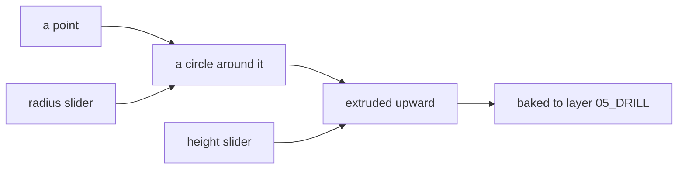

# Week 05 — goals

*Grasshopper essentials* · the essentials drill

> A goal is a **data flow**, not a list of components. It says what has to
> happen, not how. Two people building the same goal will produce different
> definitions, and comparing them is the point.

You will not be given a `.gh` file for these. [Reading one teaches nothing and the building is the skill](https://kb.rccn.dev/computation/rhino-grasshopper/grasshopper/describing-a-definition).

---

## The drill

One small flow, built **five times**, each time with the point coming from a
different source ([README §8](/Lecture/Week_05/README.md#8-many-ways-to-make-a-point-and-when-to-use-each)).
The geometry is trivial on purpose. The point is the operating: by the fifth
round, searching, wiring, previewing and baking should not need the cheatsheet.

| Round | The point comes from | Then, before moving on |
| --- | --- | --- |
| 1 | a **Panel** with `3,4,0` | put a second Panel on the extrusion: what does it say? |
| 2 | **three sliders → Construct Point** | name all three sliders |
| 3 | an **MD Slider** | turn on *preview selected only*, select only the circle |
| 4 | **Set one Point** from Rhino | move the point in Rhino and watch; then **internalise** it and move it again. What changed? |
| 5 | **computed**: the midpoint of a referenced line | change the line in Rhino. Which rounds would have survived that change? |

## After the drill

One sentence each, written in a Scribble on your canvas:

1. Which source would you use for a column on the base building's grid? Why?
2. Which round's definition would still work if you emailed it to a podmate?
3. You baked round 5 and then changed the line. Did the baked cylinder move?
