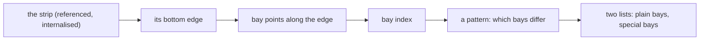
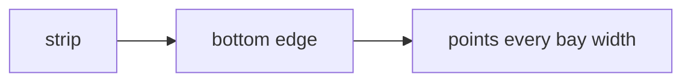
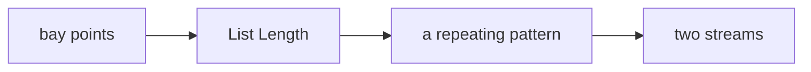
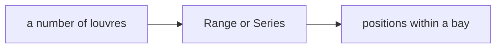

# Week 06 — goals

*Lists, ranges, and the index* · 🧱 **Class build** · part 1 of 5

> A goal is a **data flow**, not a list of components. It says what has to
> happen, not how. Two people building the same goal will produce different
> definitions, and comparing them is the point.

You will not be given a `.gh` file for these. [Reading one teaches nothing and the building is the skill](https://kb.rccn.dev/computation/rhino-grasshopper/grasshopper/describing-a-definition).

---

## The goal

A south strip of the base building, divided into structural bays; every third bay gets a different louvre spacing.

## How we build it

We build stage by stage, together. At each 🗳️ I stop: everyone votes on what goes next, *then* we build it, and the options that lost get discussed, because a wrong answer you can explain is worth more than a right one you guessed. The answers are folded away below each poll. Open them after the vote, not before.

---

### Stage 1 — From strip to bays

> 🗳️ **Poll 1** — *We have the strip's bottom edge. What do we place next?*
>
> **A.** Divide Curve · **B.** Divide Length · **C.** Series · **D.** Contour

After the vote

**We take: Divide Length.** Bays come from the building's structure, 1.5 m in this one: a length, not "12 of whatever fits". Divide Curve is right when the *count* is the given; Series gives numbers, not points; Contour cuts with planes and would also work, but says *section*, not *spacing*. Which input is given decides the component.

---

### Stage 2 — The index as a parameter

> 🗳️ **Poll 2** — *We want every third bay to be different. Which component splits the list?*
>
> **A.** List Item · **B.** Cull Pattern · **C.** Dispatch · **D.** Shift List

After the vote

**We take: Dispatch.** Dispatch sends each item to A or B by a true/false pattern (`T,F,F` repeats by itself) and keeps **both** halves. Cull Pattern throws the culled half away, and we need it. List Item picks single items. Shift List moves the start. Poll follow-up: what pattern makes bays 0, 3, 6 … special?

---

### Stage 3 — Spacing inside each bay

> 🗳️ **Poll 3** — *Louvres must start at the bay's edge and end at the next. Series or Range?*
>
> **A.** Series · **B.** Range · **C.** either · **D.** neither

After the vote

**We take: Range.** Range divides a **domain** into *n* steps and hits both ends. Series counts out *n* values from a start with a fixed step, and does not know where the bay ends. Know the end: Range. Know the step: Series.

---

## After the session

Rebuild it on **your strip**, from the diagrams only. If it only works on the class example, you built a drawing with sliders attached.
