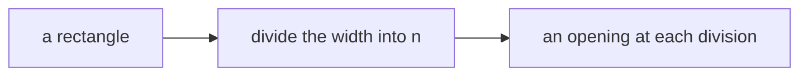
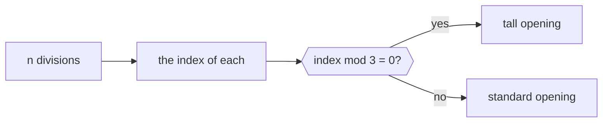
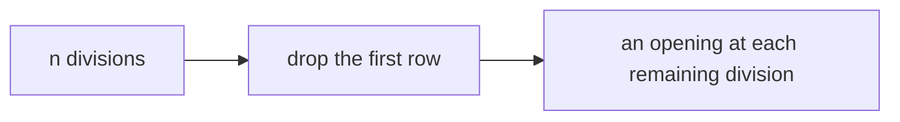

# Week 06 — goals

*Lists, ranges, and the index*

> A goal is a **data flow**, not a list of components. It says what has to
> happen, not how. Two people building the same goal will produce different
> definitions, and comparing them is the point.

You will not be given a `.gh` file for these. [Reading one teaches nothing and the building is the skill](https://kb.rccn.dev/computation/rhino-grasshopper/grasshopper/describing-a-definition).

---

## Goal 1 — A bay of openings

**Together.** I build, you build, at the same time.

*Evenly spaced, nothing clever. Get the count right before you get it interesting.*

---

## Goal 2 — Every third one is taller

**In pairs.** One drives, one navigates. Swap halfway.

*Nothing here knows about geometry. The variation comes from position in a list.*

---

## Goal 3 — Skip the ground floor

**Alone.** From the diagram only. ~15 minutes, then compare.

*Removing items from a list without breaking what comes after it.*

---

## When you are done

Three definitions that satisfy three flows. None of them is *the* answer —
compare with the person next to you and find out where you disagreed.

If you finish early: break one. Change an input until it fails, and say
which part of the flow could not cope.
