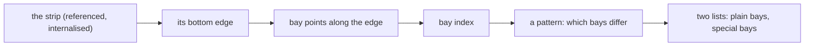
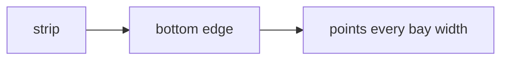
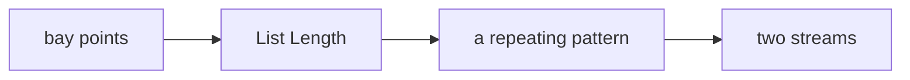
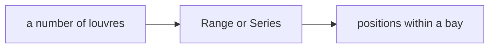
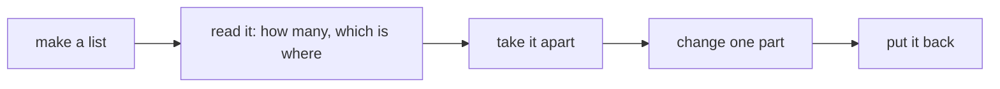
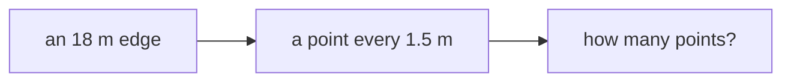
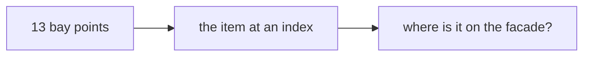
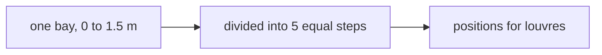
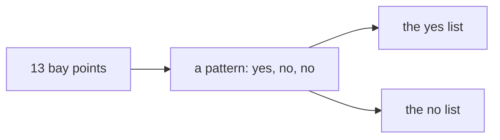
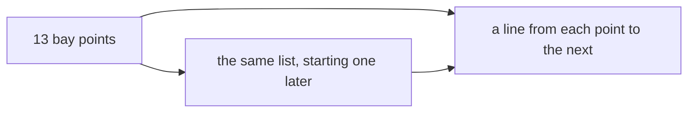

# Week 06 — goals

*Lists, ranges, and the index* · 🧱 **Class build** · part 1 of 5

> A goal is a **data flow**, not a list of components. It says what has to
> happen, not how. Two people building the same goal will produce different
> definitions, and comparing them is the point.

You will not be given a `.gh` file for these. [Reading one teaches nothing and the building is the skill](https://kb.rccn.dev/computation/rhino-grasshopper/grasshopper/describing-a-definition).

---

## First half — the example

### The goal

A south strip of the base building, divided into structural bays; every third bay gets a different louvre spacing.

### How we build it

We build stage by stage, together. At each 🗳️ I stop: everyone votes on what goes next, *then* we build it, and the options that lost get discussed, because a wrong answer you can explain is worth more than a right one you guessed. The answers are folded away below each poll. Open them after the vote, not before.

---

### Stage 1 — From strip to bays

> 🗳️ **Poll 1** — *We have the strip's bottom edge. What do we place next?*
>
> **A.** Divide Curve · **B.** Divide Length · **C.** Series · **D.** Contour

After the vote

**We take: Divide Length.** Bays come from the building's structure, 1.5 m in this one: a length, not "12 of whatever fits". Divide Curve is right when the *count* is the given; Series gives numbers, not points; Contour cuts with planes and would also work, but says *section*, not *spacing*. Which input is given decides the component.

---

### Stage 2 — The index as a parameter

> 🗳️ **Poll 2** — *We want every third bay to be different. Which component splits the list?*
>
> **A.** List Item · **B.** Cull Pattern · **C.** Dispatch · **D.** Shift List

After the vote

**We take: Dispatch.** Dispatch sends each item to A or B by a true/false pattern (`T,F,F` repeats by itself) and keeps **both** halves. Cull Pattern throws the culled half away, and we need it. List Item picks single items. Shift List moves the start. Poll follow-up: what pattern makes bays 0, 3, 6 … special?

---

### Stage 3 — Spacing inside each bay

> 🗳️ **Poll 3** — *Louvres must start at the bay's edge and end at the next. Series or Range?*
>
> **A.** Series · **B.** Range · **C.** either · **D.** neither

After the vote

**We take: Range.** Range divides a **domain** into *n* steps and hits both ends. Series counts out *n* values from a start with a fixed step, and does not know where the bay ends. Know the end: Range. Know the step: Series.

---

## Second half — the list, taken apart

The example worked. Now look at what it was made of. Every wire in it past the
first component carried a **list**, and every decision we voted on was a
decision about one: how long, which items, in what order.

**How each round works.** I describe a small flow. You **predict** the result
and vote. Only then does anyone wire it, and a **Panel** settles it. Keep the
[list cheatsheet](/Lecture/Week_06/cheatsheet.md) open: these rounds are that
page, by hand.

---

### Round 1 — How many?

> 🗳️ **Poll 4** — *An 18 m edge, a point every 1.5 m. What does List Length say?*
>
> **A.** 11 · **B.** 12 · **C.** 13 · **D.** 18

After the vote

**13.** Twelve bays, thirteen points: *n* gaps have *n + 1* posts. Say the
number you expect before you read the panel, every time. Follow-up, no vote:
make the edge 19 m. Still 13 points, and a metre left over at the end that
belongs to no bay. Divide Length does not tell you; the length does not
change. Only looking does.

---

### Round 2 — Which one?

> 🗳️ **Poll 5** — *13 points, indices 0 to 12. With Wrap on, what does index 13 give?*
>
> **A.** an error · **B.** the last point · **C.** the first point · **D.** nothing

After the vote

**The first point.** Wrap carries on round: 13 is 0 again, 14 is 1, and −1 is
the last. Turn Wrap off and the same index is a red component. Wrap is what
lets a pattern run round a closed facade, and also what turns a wrong index
into a wrong answer instead of an error. Follow-up: which index is the point
at the *west* end? It depends on which way the edge was drawn. Flip it in
Rhino and watch.

---

### Round 3 — Step or ends?

> 🗳️ **Poll 6** — *Range, on the domain 0 to 1.5, with 5 steps. How many numbers come out?*
>
> **A.** 4 · **B.** 5 · **C.** 6 · **D.** it depends on the step

After the vote

**6.** Five steps, six values, both ends included: fence posts again. Series
is the other way round: you give it the *count*, and it gives exactly that
many, with no idea where the bay ends. If two bays share a post, the last
louvre of one and the first of the next are the same line. Who owns it?

---

### Round 4 — Take it apart

> 🗳️ **Poll 7** — *Dispatch, 13 points, pattern True, False, False. How long is list A?*
>
> **A.** 3 · **B.** 4 · **C.** 5 · **D.** 13

After the vote

**5**: indices 0, 3, 6, 9, 12. And B has 8, because 5 + 8 = 13 and Dispatch
loses nothing. That sum is the check. With 12 items the answer would be 4;
the thirteenth point starts a new round of the pattern. Follow-up: you want
bays 1, 4, 7 … instead. Change the pattern, or shift the list?

---

### Round 5 — Put it back, and find the neighbours

> 🗳️ **Poll 8** — *We want one line per bay, from each point to the next. Which pair of lists do we connect?*
>
> **A.** the points, and the points reversed · **B.** the points, and the points shifted by 1 · **C.** the A and B of a Dispatch · **D.** the points, and List Length

After the vote

**The points, and the points shifted by 1.** Item *i* of one is item *i + 1*
of the other, so pairing them by index pairs every point with its neighbour.
With Wrap off the shifted list is one shorter: 12. Take the original down to
12 as well (Cull Index, the last one) before you connect them, and you have
twelve lines for twelve bays. Two lists that must be the same length: that is
next week's whole build.

---

## After the session

Rebuild it on **your strip**, from the diagrams only. If it only works on the class example, you built a drawing with sliders attached.
