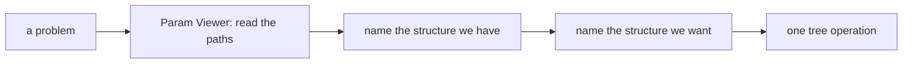
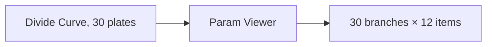
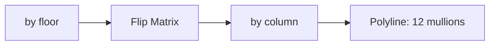
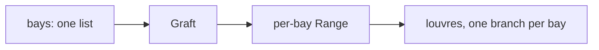
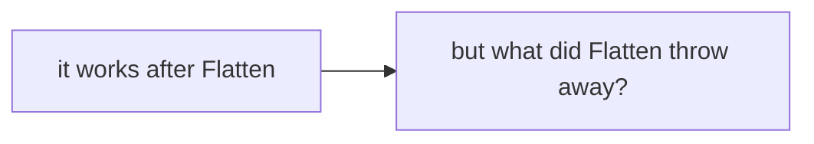

# Week 08 — goals

*Data trees: one week, on real problems* · 🌳 **Concept week** · the single data-structures week

> A goal is a **data flow**, not a list of components. It says what has to
> happen, not how. Two people building the same goal will produce different
> definitions, and comparing them is the point.

You will not be given a `.gh` file for these. [Reading one teaches nothing and the building is the skill](https://kb.rccn.dev/computation/rhino-grasshopper/grasshopper/describing-a-definition).

---

## The goal

Fix the two problems we left open: the tower's 12 mullions (W07), and louvres per bay on the facade (W06). Diagnose before touching anything.

## How we build it

We build stage by stage, together. At each 🗳️ I stop: everyone votes on what goes next, *then* we build it, and the options that lost get discussed, because a wrong answer you can explain is worth more than a right one you guessed. The answers are folded away below each poll. Open them after the vote, not before.

---

### Stage 1 — Read before you fix

> 🗳️ **Poll 1** — *Param Viewer shows 30 branches of 12 points. What do 30 and 12 mean?*
>
> **A.** 30 points, 12 curves · **B.** 30 floors, 12 points per floor · **C.** an error · **D.** 30 mullions

After the vote

**We take: 30 floors, 12 points per floor.** One branch per input curve: the *inputs* decided the structure. Read it out loud: `{0}` to `{29}` are floors, items 0 to 11 go around each floor. (12 points, not 13: on a closed curve Divide Curve does not repeat the start point. On an open curve the same count gives 13. Check which you have.)

---

### Stage 2 — Floors into columns

> 🗳️ **Poll 2** — *We have points by floor and need them by column. Which operation?*
>
> **A.** Flatten · **B.** Graft · **C.** Flip Matrix · **D.** Path Mapper

After the vote

**We take: Flip Matrix.** Flip Matrix swaps rows and columns: item *i* of every branch becomes branch *i*. Flatten puts everything in one list, giving one polyline zig-zagging through 390 points. Graft puts every point on its own branch, giving no lines at all. Path Mapper could do it, but this is exactly the case Flip Matrix exists for.

---

### Stage 3 — Louvres per bay (the facade)

> 🗳️ **Poll 3** — *Each bay needs its own Range of louvre heights. What do we do to the bay list first?*
>
> **A.** Flatten it · **B.** Graft it · **C.** nothing · **D.** Simplify it

After the vote

**We take: Graft it.** Grafting gives each bay its own branch, so Range runs once *per bay* and keeps the results apart. Without it, the louvres of all bays end up in one list, and the next component cannot tell which bay a louvre belongs to. **Flatten would hide the problem and look fine, until panel numbering in W11.**

---

### Stage 4 — The honest fix

> 🗳️ **Poll 4** — *A definition works only after you Flatten an input. What do you do?*
>
> **A.** ship it · **B.** flatten every input to be safe · **C.** find out which structure the next component expected, and why it did not get it · **D.** Path Mapper

After the vote

**We take: find out which structure the next component expected, and why it did not get it.** Flatten discards *which item belongs to which group*. Sometimes that is exactly right. When you do not know why it worked, you have hidden a bug that will come back as wrong panel numbers, mismatched louvres, or a schedule that does not add up. Diagnose it as a tree problem, not a geometry problem.

---

## After the session

Rebuild it on **your strip**, from the diagrams only. If it only works on the class example, you built a drawing with sliders attached.
