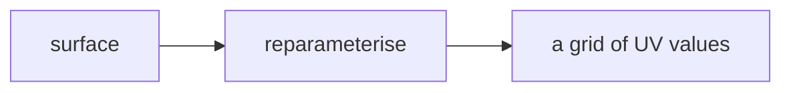
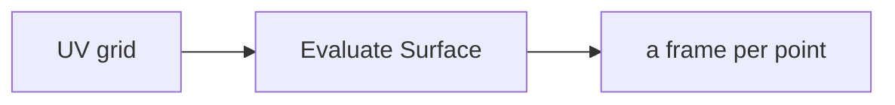
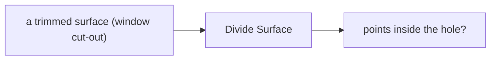

# Week 09 — goals

*Curves and surfaces, parametrically* · 🧱 **Class build** · part 2 of 5

> A goal is a **data flow**, not a list of components. It says what has to
> happen, not how. Two people building the same goal will produce different
> definitions, and comparing them is the point.

You will not be given a `.gh` file for these. [Reading one teaches nothing and the building is the skill](https://kb.rccn.dev/computation/rhino-grasshopper/grasshopper/describing-a-definition).

---

## The goal

The strip as a surface; a frame at each louvre position; a blade on each frame, aligned to the surface.

## How we build it

We build stage by stage, together. At each 🗳️ I stop: everyone votes on what goes next, *then* we build it, and the options that lost get discussed, because a wrong answer you can explain is worth more than a right one you guessed. The answers are folded away below each poll. Open them after the vote, not before.

---

### Stage 1 — Positions on the surface

> 🗳️ **Poll 1** — *We want 8 louvres per bay, on every floor. How do we get the positions on the surface?*
>
> **A.** Divide Surface · **B.** Populate Geometry · **C.** points from W06, projected · **D.** Contour

After the vote

**We take: Divide Surface.** Divide Surface returns a regular U × V grid of points **and their UV parameters**, organised as a tree (row by row: you can read it now). Populate scatters randomly. Projecting W06's points works but throws away the surface's own coordinates.

---

### Stage 2 — Orientation

> 🗳️ **Poll 2** — *Each blade must sit flat against the surface. What gives us a plane at each point?*
>
> **A.** XY Plane · **B.** Evaluate Surface · **C.** Surface Closest Point · **D.** Perp Frame

After the vote

**We take: Evaluate Surface.** Evaluate Surface at a UV gives the point, the normal *and* a frame aligned to the surface. XY Plane is the same plane everywhere. Surface Closest Point is for when you start from a point, not a UV. Perp Frame works on curves.

---

### Stage 3 — The trim trap

> 🗳️ **Poll 3** — *Our strip has a window cut out. Divide Surface still puts louvres in the hole. Why?*
>
> **A.** a bug in Grasshopper · **B.** the trim is a mask: the surface underneath is still a full rectangle · **C.** the tolerance is wrong · **D.** we forgot to reparameterise

After the vote

**We take: the trim is a mask: the surface underneath is still a full rectangle.** Week 01: every surface is a rectangle, and trimming only stores a mask. Surface components see the rectangle. The fix is to test each point against the trim (e.g. Point In Trim) and cull, deliberately.

---

## After the session

Rebuild it on **your strip**, from the diagrams only. If it only works on the class example, you built a drawing with sliders attached.
