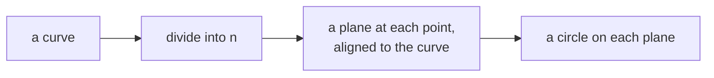
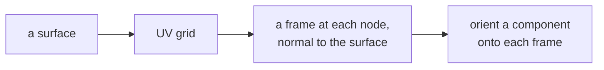
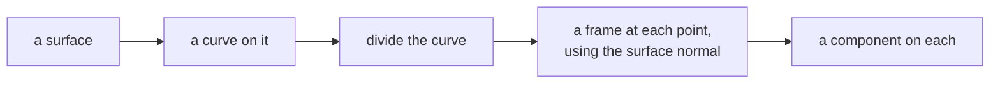

# Week 09 — goals

*Curves and surfaces, parametrically*

> A goal is a **data flow**, not a list of components. It says what has to
> happen, not how. Two people building the same goal will produce different
> definitions, and comparing them is the point.

You will not be given a `.gh` file for these. [Reading one teaches nothing and the building is the skill](https://kb.rccn.dev/computation/rhino-grasshopper/grasshopper/describing-a-definition).

---

## Goal 1 — Circles along a curve

**Together.** I build, you build, at the same time.

*Divide, evaluate, place. The `t` parameter is the whole idea.*

---

## Goal 2 — A component oriented to a surface

**In pairs.** One drives, one navigates. Swap halfway.

*The frames are the hard part. Getting them wrong looks almost right, which is worse.*

---

## Goal 3 — Along a curve, on a surface

**Alone.** From the diagram only. ~15 minutes, then compare.

*Two parameter spaces at once. If it twists, decide whether that is the frame or the surface.*

---

## When you are done

Three definitions that satisfy three flows. None of them is *the* answer —
compare with the person next to you and find out where you disagreed.

If you finish early: break one. Change an input until it fails, and say
which part of the flow could not cope.
