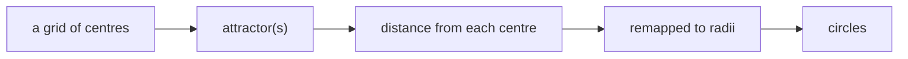
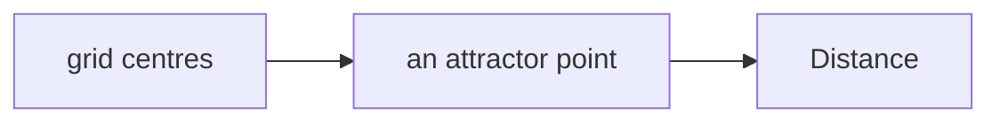
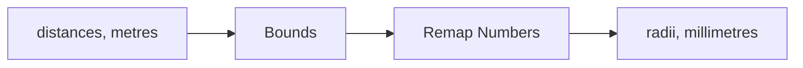
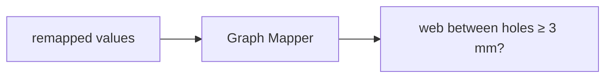

# Week 10 — goals

*A perforated screen: attractors and fields* · 🔹 **Standalone build**

> A goal is a **data flow**, not a list of components. It says what has to
> happen, not how. Two people building the same goal will produce different
> definitions, and comparing them is the point.

You will not be given a `.gh` file for these. [Reading one teaches nothing and the building is the skill](https://kb.rccn.dev/computation/rhino-grasshopper/grasshopper/describing-a-definition).

---

## The goal

A laser-cut screen: a grid of holes whose size follows distance to an attractor, with a minimum web between holes that the laser can actually cut.

## How we build it

We build stage by stage, together. At each 🗳️ I stop: everyone votes on what goes next, *then* we build it, and the options that lost get discussed, because a wrong answer you can explain is worth more than a right one you guessed. The answers are folded away below each poll. Open them after the vote, not before.

---

### Stage 1 — The driver

> 🗳️ **Poll 1** — *We have 400 centres and one attractor point. What do we measure?*
>
> **A.** Distance · **B.** Closest Point · **C.** Vector 2Pt · **D.** Area

After the vote

**We take: Distance.** One number per centre: how far it is. Closest Point is what you need when the attractor is *many* points or a curve. Vector 2Pt gives direction as well, which we do not need yet.

---

### Stage 2 — From distance to radius

> 🗳️ **Poll 2** — *Distances run from 0.2 to 9.6 m; radii must run from 4 to 18 mm. Which component?*
>
> **A.** Multiplication · **B.** Remap Numbers · **C.** Graph Mapper · **D.** Expression

After the vote

**We take: Remap Numbers.** Remap maps a **source** domain onto a **target** domain. Say both out loud: "0.2–9.6 metres onto 18–4 millimetres" (reversed, so near means big). Bounds gives the source domain from the data. Multiplication scales but cannot shift. Graph Mapper shapes the curve, which comes next.

---

### Stage 3 — Shape the falloff, and check it

> 🗳️ **Poll 3** — *The holes near the attractor merge into each other. Where do we fix it?*
>
> **A.** make the attractor smaller · **B.** cap the target domain so the largest radius leaves a 3 mm web · **C.** delete the merged holes · **D.** use Graph Mapper

After the vote

**We take: cap the target domain so the largest radius leaves a 3 mm web.** The constraint (the laser needs material between holes) belongs in the *domain*: maximum radius = half the spacing minus half the web. Graph Mapper changes the shape of the falloff, not its limits. Write fabrication limits into the definition as inputs, not as hope.

---

## After the session

Rebuild it on **your strip**, from the diagrams only. If it only works on the class example, you built a drawing with sliders attached.
