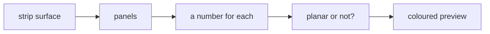
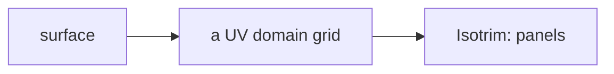
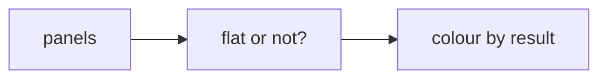
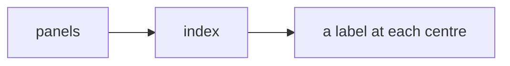

# Week 11 — goals

*Panelisation* · 🧱 **Class build** · part 3 of 5

> A goal is a **data flow**, not a list of components. It says what has to
> happen, not how. Two people building the same goal will produce different
> definitions, and comparing them is the point.

You will not be given a `.gh` file for these. [Reading one teaches nothing and the building is the skill](https://kb.rccn.dev/computation/rhino-grasshopper/grasshopper/describing-a-definition).

---

## The goal

The strip surface panelised; every panel numbered; non-planar panels flagged in red before anyone orders glass.

## How we build it

We build stage by stage, together. At each 🗳️ I stop: everyone votes on what goes next, *then* we build it, and the options that lost get discussed, because a wrong answer you can explain is worth more than a right one you guessed. The answers are folded away below each poll. Open them after the vote, not before.

---

### Stage 1 — Cut the surface

> 🗳️ **Poll 1** — *We want 1.5 × 1.2 m panels that follow the surface. What do we place?*
>
> **A.** Divide Surface · **B.** Isotrim (SubSrf) with Divide Domain² · **C.** Lunchbox Quad Panels · **D.** Contour twice

After the vote

**We take: Isotrim (SubSrf) with Divide Domain².** Divide Domain² splits the surface's UV domain into a grid; Isotrim cuts the surface along it into *surfaces*, one per panel. Lunchbox gives the same in one plug-in component, which is fine once you know what it does inside. Divide Surface gives points, not panels.

---

### Stage 2 — Can it be built?

> 🗳️ **Poll 2** — *Which panels are flat enough for flat glass?*
>
> **A.** look at them · **B.** test each panel's planarity, numerically · **C.** they are all flat, because the grid is regular · **D.** bake and check in Rhino

After the vote

**We take: test each panel's planarity, numerically.** On a doubly-curved surface a four-cornered panel is usually twisted, and by a few millimetres you cannot see. Test it per panel (the corner points against a fitted plane), and colour the failures with Custom Preview. A number, not a look.

---

### Stage 3 — Identity

> 🗳️ **Poll 3** — *Panels must be numbered so that 'F2-B4-07' on the drawing is panel 07 in the cut file. Where does the number come from?*
>
> **A.** the list index · **B.** a number typed per panel · **C.** the order Rhino bakes them in · **D.** a counter that resets per bay and floor

After the vote

**We take: a counter that resets per bay and floor.** The list index works until the list changes, then every number shifts. Panel identity should come from *where the panel is* (floor, bay, position in the bay), which is exactly the tree path from W08. Labels from paths survive edits; labels from list order do not.

---

## After the session

Rebuild it on **your strip**, from the diagrams only. If it only works on the class example, you built a drawing with sliders attached.
