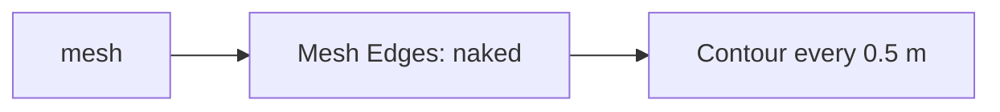

# Week 12 — goals

*A site from survey points: meshes* · 🔹 **Standalone build**

> A goal is a **data flow**, not a list of components. It says what has to
> happen, not how. Two people building the same goal will produce different
> definitions, and comparing them is the point.

You will not be given a `.gh` file for these. [Reading one teaches nothing and the building is the skill](https://kb.rccn.dev/computation/rhino-grasshopper/grasshopper/describing-a-definition).

---

## The goal

The site terrain from a cloud of survey points: a mesh, its slope shown as colour, contours every 0.5 m for the site model.

## How we build it

We build stage by stage, together. At each 🗳️ I stop: everyone votes on what goes next, *then* we build it, and the options that lost get discussed, because a wrong answer you can explain is worth more than a right one you guessed. The answers are folded away below each poll. Open them after the vote, not before.

---

### Stage 1 — Points to surface

> 🗳️ **Poll 1** — *We have 600 scattered survey points. What makes a terrain from them?*
>
> **A.** Patch · **B.** Loft · **C.** Delaunay Mesh · **D.** Surface from Points

After the vote

**We take: Delaunay Mesh.** Delaunay triangulates scattered points directly, every point becoming a vertex. Surface from Points needs a regular grid, which survey points are not. Patch approximates and moves your measured heights. Loft needs ordered curves. Measured data wants a mesh.

---

### Stage 2 — Read the terrain

> 🗳️ **Poll 2** — *We want each triangle coloured by how steep it is. Where does steepness come from?*
>
> **A.** the height of its vertices · **B.** the angle between its normal and Z · **C.** its area · **D.** the contour spacing

After the vote

**We take: the angle between its normal and Z.** A flat face's normal points straight up (0°); a vertical face's normal is horizontal (90°). Height tells you altitude, not steepness. Contour spacing shows slope to the eye, but not per face.

---

### Stage 3 — Edges and contours

> 🗳️ **Poll 3** — *Which edges of the terrain mesh are its site boundary?*
>
> **A.** all edges · **B.** naked edges · **C.** interior edges · **D.** the longest edges

After the vote

**We take: naked edges.** A naked edge belongs to only one face, so it is on the boundary. (Interior edges have two faces.) The same idea finds holes in a scan: naked edges where there should be none.

---

## After the session

Rebuild it on **your strip**, from the diagrams only. If it only works on the class example, you built a drawing with sliders attached.
