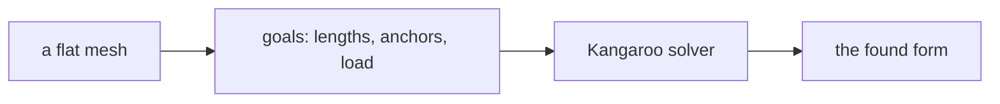
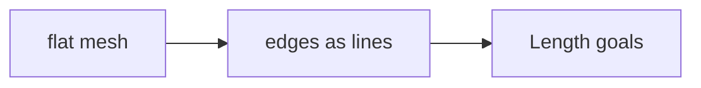
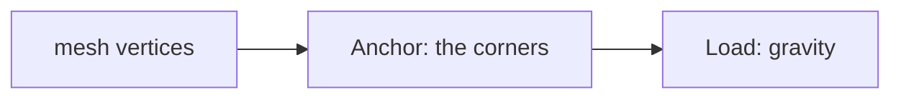
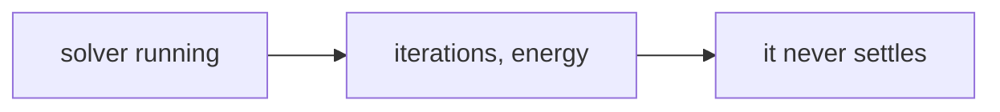

# Week 13 — goals

*A hanging canopy: form-finding* · 🔹 **Standalone build**

> A goal is a **data flow**, not a list of components. It says what has to
> happen, not how. Two people building the same goal will produce different
> definitions, and comparing them is the point.

You will not be given a `.gh` file for these. [Reading one teaches nothing and the building is the skill](https://kb.rccn.dev/computation/rhino-grasshopper/grasshopper/describing-a-definition).

---

## The goal

A fabric canopy over the courtyard: a mesh hung from four posts, relaxed into equilibrium, then inverted into a compression shell.

## How we build it

We build stage by stage, together. At each 🗳️ I stop: everyone votes on what goes next, *then* we build it, and the options that lost get discussed, because a wrong answer you can explain is worth more than a right one you guessed. The answers are folded away below each poll. Open them after the vote, not before.

---

### Stage 1 — Turn a mesh into goals

> 🗳️ **Poll 1** — *Kangaroo needs to know what should stay the same length. Where do the springs come from?*
>
> **A.** the mesh faces · **B.** the mesh edges · **C.** the vertices · **D.** a slider

After the vote

**We take: the mesh edges.** Each edge becomes a Length goal: a spring between its two vertices. Faces carry no spring; vertices are what move.

---

### Stage 2 — Hold it up

> 🗳️ **Poll 2** — *We press play and the whole mesh falls away. What is missing?*
>
> **A.** more Length goals · **B.** Anchors on the support points · **C.** a bigger load · **D.** Weld Mesh

After the vote

**We take: Anchors on the support points.** Without anchors nothing holds the net, so gravity wins. Anchors fix chosen vertices in place; pick them by index or by closest point to the posts, never by hand.

---

### Stage 3 — Read the solver

> 🗳️ **Poll 3** — *The solver keeps running and the shape keeps jittering. First thing to check?*
>
> **A.** add iterations · **B.** conflicting goals: anchors and lengths that cannot both be satisfied · **C.** restart Rhino · **D.** lower the load

After the vote

**We take: conflicting goals: anchors and lengths that cannot both be satisfied.** A solver that will not settle is usually being asked for the impossible: anchors further apart than the springs can reach, or two goals pulling on one vertex. Read the energy, change one goal at a time. Flip the settled form upside down and you have Gaudí's and Isler's method: hanging tension inverted into compression.

---

## After the session

Rebuild it on **your strip**, from the diagrams only. If it only works on the class example, you built a drawing with sliders attached.
