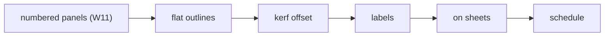
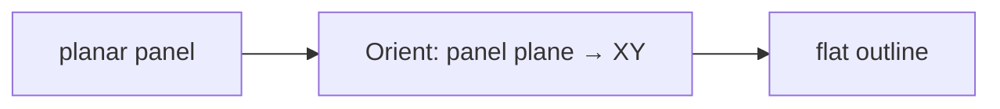
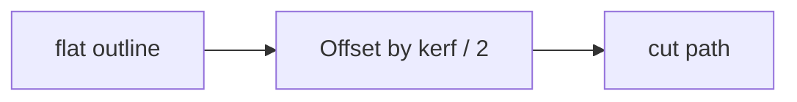
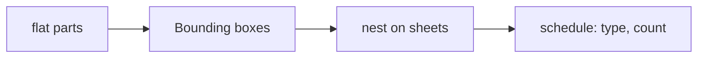

# Week 14 — goals

*Fabrication prep: flatten, label, lay out* · 🧱 **Class build** · part 4 of 5

> A goal is a **data flow**, not a list of components. It says what has to
> happen, not how. Two people building the same goal will produce different
> definitions, and comparing them is the point.

You will not be given a `.gh` file for these. [Reading one teaches nothing and the building is the skill](https://kb.rccn.dev/computation/rhino-grasshopper/grasshopper/describing-a-definition).

---

## The goal

Cut sheets for the strip's panels: flat, labelled, kerf-offset, laid out on 2440 × 1220 sheets, plus a panel schedule.

## How we build it

We build stage by stage, together. At each 🗳️ I stop: everyone votes on what goes next, *then* we build it, and the options that lost get discussed, because a wrong answer you can explain is worth more than a right one you guessed. The answers are folded away below each poll. Open them after the vote, not before.

---

### Stage 1 — Lay it flat

> 🗳️ **Poll 1** — *Our panels are planar. How do we lay each one flat on the XY plane?*
>
> **A.** Project onto XY · **B.** Orient from the panel's plane to XY · **C.** Unroll Brep · **D.** Scale Z to 0

After the vote

**We take: Orient from the panel's plane to XY.** Orient moves and rotates rigidly, so lengths are untouched. Project and Scale-to-zero *squash* a tilted panel and shorten it, the classic "it cut too small" error. Unroll is for non-planar, developable pieces; on a planar panel it is just a slower Orient.

---

### Stage 2 — Kerf

> 🗳️ **Poll 2** — *The laser burns away 0.2 mm. Which way do we offset the cut line?*
>
> **A.** inwards · **B.** outwards · **C.** not at all · **D.** half each way

After the vote

**We take: outwards.** The beam removes material centred on the path, so a part cut on its true outline comes out 0.1 mm too small on every side. Offset the part's outline **outwards** by kerf / 2. (A hole is the opposite: offset inwards.) Kerf is an input with a name, never a magic number.

---

### Stage 3 — Layout and count

> 🗳️ **Poll 3** — *We want the panel schedule: how many of each panel type. What do we use?*
>
> **A.** List Length · **B.** Create Set + Member Index · **C.** Sort List · **D.** count in Rhino

After the vote

**We take: Create Set + Member Index.** Create Set gives each distinct type once; Member Index finds how many times each appears. This is the order the workshop needs: 46 × type A, 12 × type B … List Length only counts everything.

---

## After the session

Rebuild it on **your strip**, from the diagrams only. If it only works on the class example, you built a drawing with sliders attached.
