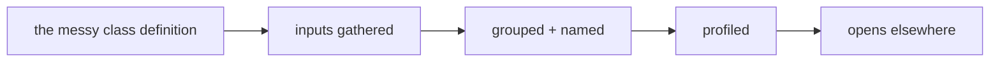
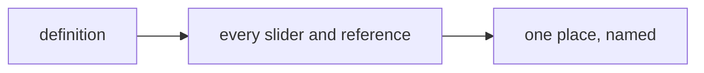
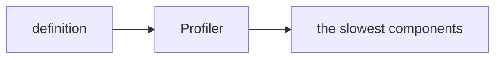
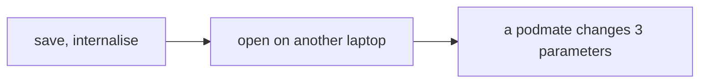

# Week 15 — goals

*Make it readable, make it fast* · 🧱 **Class build** · part 5 of 5

> A goal is a **data flow**, not a list of components. It says what has to
> happen, not how. Two people building the same goal will produce different
> definitions, and comparing them is the point.

You will not be given a `.gh` file for these. [Reading one teaches nothing and the building is the skill](https://kb.rccn.dev/computation/rhino-grasshopper/grasshopper/describing-a-definition).

---

## The goal

The class definition, cleaned for a reader: inputs gathered and named, one group per step, slow parts found and fixed, and it opens on a stranger's laptop.

## How we build it

We build stage by stage, together. At each 🗳️ I stop: everyone votes on what goes next, *then* we build it, and the options that lost get discussed, because a wrong answer you can explain is worth more than a right one you guessed. The answers are folded away below each poll. Open them after the vote, not before.

---

### Stage 1 — Find the inputs

> 🗳️ **Poll 1** — *A stranger opens our definition. What should they see first?*
>
> **A.** the output geometry · **B.** the inputs that matter, gathered and named · **C.** a cluster · **D.** the longest group

After the vote

**We take: the inputs that matter, gathered and named.** At the review I name three parameters and you change them. A reader starts the same way: what can I steer? Gather the driving sliders on the left, named in the language of the project ("bay width", not "Slider 4").

---

### Stage 2 — What is slow?

> 🗳️ **Poll 2** — *Moving one slider takes 8 seconds. What do we check first?*
>
> **A.** buy a faster computer · **B.** the Profiler: which components take the time · **C.** delete previews · **D.** make a cluster

After the vote

**We take: the Profiler: which components take the time.** Measure before you fix. Usually it is one component (a boolean, a heavy preview, a huge tree flowing where it does not need to), and a Data Dam or a disabled preview downstream fixes most of it. Clustering hides slowness; it does not remove it.

---

### Stage 3 — Could someone else drive this?

> 🗳️ **Poll 3** — *It opens on your machine. Is it finished?*
>
> **A.** yes · **B.** only once it opens on someone else's machine and they can steer it · **C.** once it is clustered · **D.** once it is baked

After the vote

**We take: only once it opens on someone else's machine and they can steer it.** That is the course question, and the brief's first criterion: it runs on another machine. Swap laptops with your podmate now, not on review day.

---

## After the session

Rebuild it on **your strip**, from the diagrams only. If it only works on the class example, you built a drawing with sliders attached.
