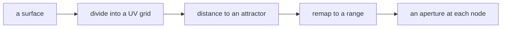

# The pattern library

One recipe per student, due Week 15. Fifty of these is a genuinely useful
reference, and it is yours after the course.

## What a recipe is

A small, working, documented definition that solves **one** problem well.
Fifteen components, not five hundred. It may come out of your project, but it
has to stand alone — someone who is not doing your variant should be able to
open it and use it.

## Format

```
library/<your-id>-<short-name>/
├── README.md        the flow, then what it does / inputs / outputs / one gotcha
├── recipe.gh        internalised, opens anywhere
└── preview.png      one image, showing the output
```

**The README leads with a flow diagram, and that is the part people will
actually read.** A Mermaid flowchart of what goes in, what happens, what comes
out — no component names:

````markdown

````

Then four short sections: **what it does** (one sentence), **inputs** (with
units and sensible ranges), **outputs**, and **one gotcha** — the thing that
will waste someone an hour if nobody says it.

Someone should be able to decide in fifteen seconds whether this is what they
need, and understand the approach without opening Rhino.

Why the diagram rather than just the file: a `.gh` cannot be read, cannot be
diffed, and hands over the answer without the thinking. The full argument is on
the wiki — [Describing a
Definition](https://kb.rccn.dev/computation/rhino-grasshopper/grasshopper/describing-a-definition).
The file still ships, for running; it is just not the explanation.

## Before you submit

Your pod opens it on their own machine and runs it. If it does not open, it is
not done — that is the whole point of the exercise.

Contributing is part of the gate, not part of the grade.
