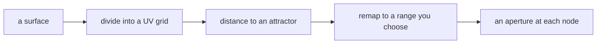

# ARCH2022 Computational Design Fundamental

Rhino and Grasshopper for architectural design. The first quarter is **modelling
with intent**: what Rhino is actually good at, and how to build a model that
survives contact with a deadline. The rest is **Grasshopper**, taught as a
practical skill.

Two claims shape how this course runs.

**You do not learn software in a classroom. You learn it by using it on
something you care about.** Every hour of watching someone else model is worth
about ten minutes of doing it yourself. So the room is for the things you cannot
do alone — building alongside someone who is faster than you, having your work
looked at, and arguing about whether something is good. Reference material is
homework, because reading is something you are already able to do at your own
pace, at 2am, with the page open beside Rhino.

**Fluency is physical.** Nobody becomes good at Grasshopper by understanding it.
They become good by having built the same kind of thing enough times that their
hands go to the right component without asking. That is why most Grasshopper
sessions are **builds**, not lectures — see [Three goals](#three-goals).

* TBC-COURSE-CODE · **TBC-DAY TBC-TIME** · TBC-ROOM
* First session **TBC-DATE** · Office hour TBC · TBC-EMAIL
* **New here? → [Setup](SETUP.md)** · stuck? → [Troubleshooting](TROUBLESHOOTING.md)

---

## Schedule

### Part I — Rhino: the anatomy, and how to drive it (W01–W04)

| Week | Topic | Concepts | Practice |
| ---- | ----- | -------- | -------- |
| **01** | **The anatomy of a Rhino model ⭐** 👉[Lecture](/Lecture/Week_01/README.md) 🎬[Slides](https://slides.rccn.dev/courses/CDF/CDF-W01/) | · command line as the interface, hotkeys, aliases · data types: point / curve / surface / poly* / mesh / SubD · what a NURBS is — control points, degree, knots · every surface is a rectangle; trimming stores a mask · join, polysurface, and "solid" is not a type · units and tolerance, and why booleans fail · nested layers, lock, colour, print width · named views, F6 camera, CPlane + Plan | Set up · model one closed solid · trim + Untrim demo · save 3 named views · [self-check](/SELF-CHECK.md) clean |
| **02** | **Making things: curves into surfaces** 👉[Lecture](/Lecture/Week_02/README.md) 🎬[Slides](https://slides.rccn.dev/courses/CDF/CDF-W02/) | · InterpCrv vs Curve: through-points vs pulled-toward · continuity: G0 touch, G1 tangent, G2 matching curvature · surfaces are as good as the curves under them · which surface command, and when · trim, split, join, cap — and what breaks each | Rebuild W01 element from clean curves · one double-curved surface passing `Zebra` · one filleted solid |
| **03** | **Working at scale** 👉[Lecture](/Lecture/Week_03/README.md) 🎬[Slides](https://slides.rccn.dev/courses/CDF/CDF-W03/) | · the `Sel*` family; window vs crossing selection · naming, and why Grasshopper will care from W05 · blocks: when worth it, when ceremony · referencing versus copying the site file · model hygiene as a routine, not a hand-in step · what to model and what to fake | Reorganise into numbered nested layers · one block placed ≥3× · name what GH will need · **pods form** |
| **04** | **Getting it out** 👉[Lecture](/Lecture/Week_04/README.md) 🎬[Slides](https://slides.rccn.dev/courses/CDF/CDF-W04/) | · Make2D is static and slow; tangent-edges matter · annotation styles, and `Dot` for panel numbers later · layouts, details, per-detail scale + lock · print width per layer, independent of screen · `ViewCaptureToFile` with a deliberate display mode · unrolling — developable vs not | One sheet (plan/elev/section, stated scale, PDF) · one 2000 px+ image · one element unrolled · 🎓 **brief released** |

### Part II — Grasshopper: the fundamentals (W05–W10)

The weeks people find hardest, in the order that hurts least. Data trees get
two weeks because one is a lie.

| Week | Topic | Concepts | Practice |
| ---- | ----- | -------- | -------- |
| **05** | **The canvas and the flow** 👉[Lecture](/Lecture/Week_05/README.md) 🎬[Slides](https://slides.rccn.dev/courses/CDF/CDF-W05/) | · params vs components; what a wire carries · referencing Rhino geometry — internalise from day one · the panel is the only debugger you get · group and name as you build | Three [goals](/Lecture/Week_05/goals.md) · **variant assigned** |
| **06** | **Lists, ranges, and the index** 👉[Lecture](/Lecture/Week_06/README.md) 🎬[Slides](https://slides.rccn.dev/courses/CDF/CDF-W06/) | · `Series` vs `Range` — pick the right one · indexing, negative indices, going past the end · the index as a design parameter | Three [goals](/Lecture/Week_06/goals.md) · drive one thing in your strip by index |
| **07** | **Data trees I — what a path is** 👉[Lecture](/Lecture/Week_07/README.md) 🎬[Slides](https://slides.rccn.dev/courses/CDF/CDF-W07/) | · `{0;1;2}` is a sentence — read it out loud · inputs decide the output's structure · matching: shortest, longest, cross-reference · read the tree *before* fixing it | Three [goals](/Lecture/Week_07/goals.md) · Param Viewer in 3 places in your definition |
| **08** | **Data trees II — graft, flatten, and the honest fix** 👉[Lecture](/Lecture/Week_08/README.md) 🎬[Slides](https://slides.rccn.dev/courses/CDF/CDF-W08/) | · what graft/flatten/simplify actually do to paths · the flatten reflex hides bugs it does not fix · `Path Mapper` is a last resort — something upstream is wrong · diagnose as a tree problem, not a geometry problem | Three [goals](/Lecture/Week_08/goals.md) · 🎓 **concept review** (sketch + paragraph + reference) |
| **09** | **Curves and surfaces, parametrically** 👉[Lecture](/Lecture/Week_09/README.md) 🎬[Slides](https://slides.rccn.dev/courses/CDF/CDF-W09/) | · the `t` parameter; reparameterising to 0–1 · surface UV — the Week 01 rectangle again · frames and planes — orient without fighting · trims are masks; surface components see the rectangle | Three [goals](/Lecture/Week_09/goals.md) · W02 surface returns, driven parametrically |
| **10** | **Attractors, remapping, fields** 👉[Lecture](/Lecture/Week_10/README.md) 🎬[Slides](https://slides.rccn.dev/courses/CDF/CDF-W10/) | · distance as a driver — point, curve, surface attractors · `Remap Numbers`: name both domains out loud · shape a falloff deliberately with `Graph Mapper` · is the variation *doing* anything? | Three [goals](/Lecture/Week_10/goals.md) · choose a driver for your strip, defend it |

### Part III — Grasshopper: systems (W11–W15)

| Week | Topic | Concepts | Practice |
| ---- | ----- | -------- | -------- |
| **11** | **Panelisation and subdivision** 👉[Lecture](/Lecture/Week_11/README.md) 🎬[Slides](https://slides.rccn.dev/courses/CDF/CDF-W11/) | · quad, triangular, diamond, hexagonal grids · planarity: quads on a double-curved surface are not flat · panel numbering — identity through the pipeline · the seam and the pole — where a surface betrays you | 🎓 **iteration 1** — the system generates, roughly, on your strip |
| **12** | **Meshes, and when not to use NURBS** 👉[Lecture](/Lecture/Week_12/README.md) 🎬[Slides](https://slides.rccn.dev/courses/CDF/CDF-W12/) | · mesh vs NURBS — what each is good at, what each costs · topology: vertices, faces, naked edges, welding · when to convert, in which direction · meshes from scans and surveys | Three [goals](/Lecture/Week_12/goals.md) · decide *in writing* which your system uses |
| **13** | **Form-finding** 👉[Lecture](/Lecture/Week_13/README.md) 🎬[Slides](https://slides.rccn.dev/courses/CDF/CDF-W13/) | · relaxation as a method, not an effect · anchors and springs; reading a solver that will not settle · form as a consequence of physical constraints | Three [goals](/Lecture/Week_13/goals.md) · take it into the project if it fits |
| **14** | **Fabrication prep: unroll, nest, label** 👉[Lecture](/Lecture/Week_14/README.md) 🎬[Slides](https://slides.rccn.dev/courses/CDF/CDF-W14/) | · unrolling from Grasshopper; developable vs not · nesting, sheet efficiency, material constraints as inputs · labelling — identity surviving to the cut file · tolerance and kerf: the gap between model and machine | 🎓 **iteration 2** — fabricable, scheduled, unrolled |
| **15** | **Definition hygiene and performance** 👉[Lecture](/Lecture/Week_15/README.md) 🎬[Slides](https://slides.rccn.dev/courses/CDF/CDF-W15/) | · group, name, colour — lay out a definition to be read · internalise data; make the file open elsewhere · what is actually slow: previews, recomputation, huge trees · the review question: could someone else drive this? | Clean your definition for a reader · 📚 **library recipe** · pod review |

> **How to change this schedule.** The **Concepts** column here is the week's topic outline — the syllabus preview students see up front. The **actual commands** taught each week live in a `## Commands` section inside `Lecture/Week_NN/README.md`, not in this table — the lecture page is the source of truth. Edit either; keep them roughly in step (a bullet added to Concepts usually means a command or two added to that week's page). Deck: `slides/courses/CDF/CDF-WNN.md`.

### Part IV — Build (W16–W18)

| Week | Session | Milestone |
| ---- | ------- | --------- |
| 16 | 🎬[Slides](https://slides.rccn.dev/courses/CDF/CDF-W16/) · **Pod clinic** — rotating, 15 minutes per pod, in front of everyone. | 🎓 **freeze** |
| 17 | **Production** — drawings, images, the definition cleaned for a reader. Defences begin, by pod. 🎬[Slides](https://slides.rccn.dev/courses/CDF/CDF-W17/) | 📝 **defences (A + B)** |
| 18 | 🎓 **Final review** — the definition driven live, and the question answered out loud. 🎬[Slides](https://slides.rccn.dev/courses/CDF/CDF-W18/) | 🎓 **submission** · 📝 review due |

---

## How this course is assessed

**The project is your grade — 100%.** There is no exam.

The Rhino work in Weeks 01–05 is not scored, but it is a **required gate**: your
Week 05 model becomes your project base, and everything after Week 06 assumes a
model you can trust. Check it yourself with [SELF-CHECK.md](/SELF-CHECK.md).

The criteria are in the [project brief](/Project/README.md#assessment). The theme
throughout: **the definition is the deliverable, not the render.** A beautiful
image from a definition nobody can open or change is worth less here than a
plain one a stranger could pick up and steer.

### The oral defence

The project is assessed with the file open, in front of you.

- I name **three parameters**. Change them, and say what should happen *before*
  it does
- I point at **one component**. Why is it there? What breaks without it?
- One change you have not seen, made live, in fifteen minutes

That last part is the course question turned around. All term it has been *could
someone else drive this?* At the review: **can you?**

You will have had an assistant, a forum and fifty tutorials open all semester,
and so will everyone you ever work with. Pretending otherwise would measure your
willingness to play along rather than your ability. So the position is simple:

> **Anything you hand in can be helped. Nothing you say out loud can be.**

Take all the help you like, in whatever form leaves you able to drive the result
and say why it is that way. A definition you cannot explain scores as though you
had not submitted it — which is a statement about evidence, not about your
character, and requires nobody to accuse anybody of anything.

No AI detectors are used in this course. They are unreliable and they poison the
thing they are meant to protect.

## The problem with 50 students

You learn this on your own project. There are fifty of you and one of me, so
"bring your own project and I will help" does not work — a demo that answers
your question is thirty minutes of everyone else waiting.

So the course splits the difference:

**One brief, fifty variants.** Everyone solves the same problem, and each of you
gets a different site strip, orientation and programme. Because the problem is
shared, every demo transfers to everybody. Because the variant is yours, the
design decisions are yours and no two submissions look alike.

**Pods of five.** From Week 03 you belong to a pod. Your pod reviews each
other's work before it reaches me, which turns 1:50 into an effective 1:4. Each
week one pod question comes to class — chosen by the pod, asked out loud.

**The pattern library.** Every student contributes one working, documented
definition to a shared class library. Fifty students produce fifty teaching
artefacts, and the library is yours to keep. Contributing is part of the gate.

**Clinics, not tutorials.** Weeks 10, 15 and 16 are pod clinics: fifteen minutes
per pod, in front of the room. You will get less individual attention than you
want and more useful attention than a private tutorial would give you, because
four other people's problems will turn out to be yours too.

## Three goals

Most Grasshopper sessions run on the same format, and it is the reason to come.

Each session has **three goals**, each stated as a **data flow** — what has to
happen, not which components to use. They escalate:

1. **Together.** I build, you build, at the same time. Not copying a screenshot
   — building, at the pace of someone explaining. If you fall behind, say so;
   that is data, not failure.
2. **In pairs.** One drives, one navigates. Swap halfway. The navigator's job is
   to be right, not polite.
3. **Alone.** From the diagram only, ~15 minutes, from an empty canvas.

Goal 3 is the one that does the work, and the one people want to skip. Being
able to follow along is not the same as being able to build it, and the gap
between those two is exactly where the confidence you need comes from.

Each week's goals are in `Lecture/Week_NN/goals.md`. Read them before class.

### Why you never get the `.gh` file

A goal looks like this:

Notice what it does not say: no component names, no wiring, no plugin. It states
the **problem** at the level you can solve independently.

That is deliberate, for three reasons. A `.gh` file **cannot be read** — opening
one shows a canvas in the order someone happened to place things, and working
out the intent takes longer than rebuilding it. It **cannot be versioned** —
it is binary, so git records that something changed and never what. And if the
point is for you to learn the definition, **handing you the file removes the
only part that teaches.**

So two people given the same goal will build different definitions that both
satisfy it. Comparing those two is where the useful conversation is, and it is
what pod review is for.

The general version of this argument, and how to document your own work:
[rccn wiki → Describing a Definition](https://kb.rccn.dev/computation/rhino-grasshopper/grasshopper/describing-a-definition).

Goals come back. Something you built in Week 06 reappears in Week 10 with one
box changed. That spacing is deliberate.

## AI

Not prohibited, and not the point.

Grasshopper is a visual language, and the assistants are markedly weaker at it
than at Python — they will confidently describe components that do not exist and
wirings that cannot work. Treat anything one tells you about Grasshopper as a
hypothesis to test on the canvas, not as an answer.

Where it genuinely helps: explaining an error you do not recognise, suggesting
what a component is called when you know what you want but not its name, working
through the maths behind a remap, and drafting the written parts of your
submission. Use it for those.

The one hard rule is the same as everywhere else here: **you explain what you
submit.** At the final review the definition gets opened and you get asked why a
component is there. "It was in the file I found" is not an answer, whether the
file came from a model, a forum, or a friend.

This course teaches components, not code. If you want to write scripts —
Python inside Grasshopper, or COMPAS outside it — that is
[DCCG](https://github.com/raccoon-ncku/DCCG), and it pairs well with this one.

General guidance, not course-specific:
[rccn wiki → AI Assistants](https://kb.rccn.dev/computation/ai-assistants).

## Where things live

| | |
| --- | --- |
| **This repo** | the course — schedule, week-by-week lectures, checkpoints, the brief |
| [**rccn wiki**](https://kb.rccn.dev/computation/rhino-grasshopper) | the reference — Rhino and Grasshopper how-to that outlives any one semester |
| **Slides** | the room — what happens in the session, and nothing you need afterwards |

If a fact is true regardless of this course, it belongs on the wiki and this
repo links to it. That is why the lectures are shorter than you expect.
